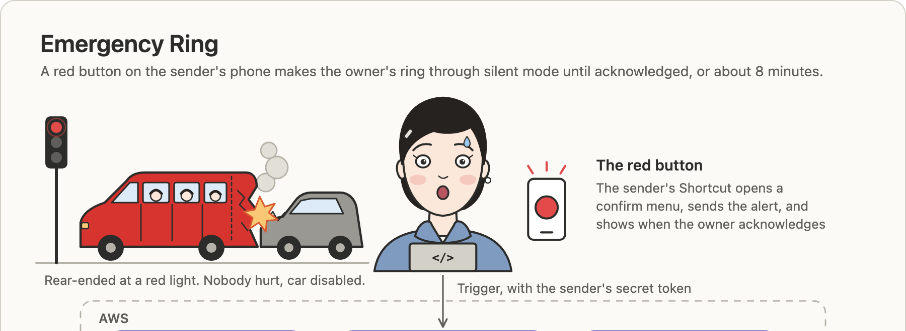
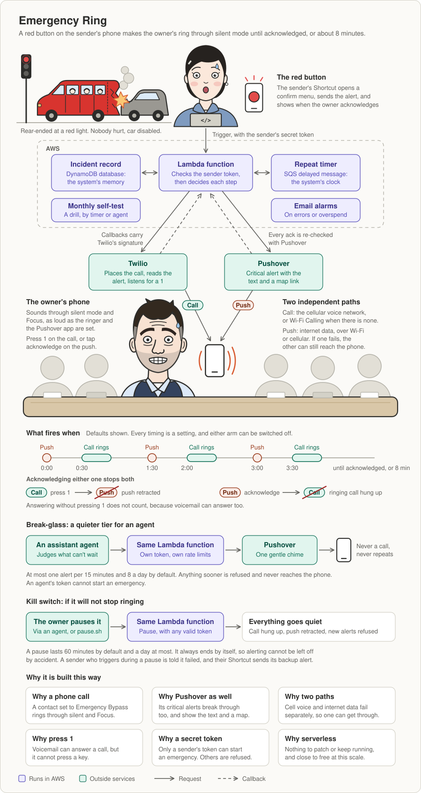

# Emergency Ring

> "Only a few people had the power to make this happen."
>
> Neal Stephenson, *Termination Shock*, on an aide's phone that vibrates only
> for the people who matter. That line is why this project was started.

Emergency Ring lets the people you trust make your iPhone sound through silent
mode and any Focus, when it is a real emergency. It also lets an AI agent of
your own decide, by rules you give it, that something cannot wait.

[](#how-it-works)

**The problem.** To protect deep work or sleep you silence the phone, and then
the people who matter cannot reach you when something has gone wrong. The usual
fix lets a few contacts through all the time, and with them their ordinary
calls and texts.

**What this does about it.** Your phone stays silent and in a strict Focus the
rest of the time. A trusted sender (a spouse, a co-parent, a carer; as many as
you give a token to) taps a Shortcut and says what kind of emergency it is.
Your phone sounds a critical alert that names the sender and the kind, with a
map link, then rings from a number that silence lets through. Both repeat until
you acknowledge, or for about eight minutes with the default settings, and the
sender sees whether you did. A backup number, a kill switch, labelled drills
and a monthly self-test come with it. You keep the time and attention that
ordinary interruptions take from focused work.

**An agent that can break the glass.** Not everything that cannot wait comes
from a person who can press a button. A second tier, called break-glass, serves
an *agent*: a program of your own that runs all the time, for example an AI
assistant that reads your messages, mail and calendar. You tell it in your own
words what is worth interrupting you for, and it decides case by case, at any
hour, without anyone pressing anything. When it decides yes, it gets one gentle
alert through your silence: never a call, never repeated, at most one per 15
minutes and 8 a day by default. Its token cannot start an emergency. Together
the two tiers make a strict Focus safe to keep on: the agent watches what you
no longer look at, and a person can still ring you outright.
[docs/break-glass.md](docs/break-glass.md) has the contract, and guidance to
give the agent. The rest works without one.

**Status.** This is the first release. The main path has been drilled on a live
deployment with real phones. Most of the code that handles failures has run
only in the unit tests. [What has been exercised for
real](#what-has-been-exercised-for-real) lists both.

**Who it is for.** Someone comfortable deploying a small AWS SAM stack for
their own household.

**What it needs.**

- An iPhone for the person being alerted (the *owner*). Both alert arms rely on
  iOS: Critical Alerts through the Pushover app, and Emergency Bypass for a
  contact.
- An AWS account. One household's use is a handful of requests, so expect the
  AWS charges to be cents a month at most.
- For the push arm, [Pushover](https://pushover.net/pricing): an app licence,
  bought once per platform after a trial.
- For the call arm, a [Twilio](https://www.twilio.com/en-us/voice/pricing)
  number: a monthly fee for the number, plus calls by the minute.
- Either arm can be left off. Push only is the cheapest way to start and needs
  no Twilio at all.
- For the sender, the Shortcuts app on an iPhone and no account anywhere. Any
  HTTP client can trigger an alert in its place.
- A Mac to generate the sender's Shortcut. Without one you can build it by hand
  on the phone, though nobody has yet followed those steps on a device.

**What it does not do.**

- It is not a replacement for calling emergency services.
- One deployment alerts one person.
- The owner's side is built for iPhone only.
- It needs a network at both ends, and it stops by itself: an alert nobody
  acknowledges ends after about eight minutes with the defaults.

## Quick start: push only

This path uses the push arm alone, so you open no Twilio account and rent no
number.

1. Install the AWS CLI and the SAM CLI, configure credentials, clone this
   repository and pick a region. The examples and the scripts' defaults use
   `us-west-2`.
2. Pushover: create an account, install the app on the owner's iPhone, and
   create an application on pushover.net to get an application token. Note your
   user key as well; the pushover.net dashboard shows it. In the iOS app,
   enable Critical Alerts for emergency priority and set their volume.
3. Make a long random token for each sender: `openssl rand -base64 32 | tr -d
   '=+/'`
4. Store `trigger-tokens`, `pushover-app-token` and `pushover-user-key` as
   described under [Secrets](docs/deploy.md#secrets). `trigger-tokens` is JSON, one entry per
   sender: `{"Robin": "<the token from step 3>"}`.
5. Copy `samconfig.example.toml` to `samconfig.toml` (gitignored), set
   `OwnerName`, leave `CallEnabled=false`, and run `sam deploy`. No `sam build`
   is needed: the function has no dependencies to package.
6. Open the `FunctionUrl` output with `curl`. `{"error": "not found"}` means
   the function started and read its secrets. For anything else, see
   [Troubleshooting](docs/troubleshooting.md#troubleshooting).
7. Run `scripts/drill.sh` for a quiet, labelled test and acknowledge it in the
   Pushover app. Then run `scripts/drill.sh full` with the phone locked, on
   silent, in the Focus you use, and without looking at it. If your region,
   stack name or secrets prefix is not the default, tell the scripts first: see
   [Tests and drills](#tests-and-drills).
8. Give the sender their Shortcut: [docs/shortcut.md](docs/shortcut.md).
9. Read [Limits and failure modes](#limits-and-failure-modes) before you rely
   on it.

## Documentation

- [docs/deploy.md](docs/deploy.md): the rest of the set-up after the quick
  start. The call arm, alarms, sender receipts, the secrets and how to change
  one, and uninstalling.
- [docs/settings.md](docs/settings.md): every template parameter, with its
  default and limits, and how to choose the timing.
- [docs/api.md](docs/api.md): the HTTP routes, who may call each, and what
  they answer.
- [docs/shortcut.md](docs/shortcut.md): the sender's Shortcut, generated or
  built by hand.
- [docs/break-glass.md](docs/break-glass.md): the agent tier, its contract,
  and guidance to give the agent.
- [docs/troubleshooting.md](docs/troubleshooting.md): what to check when
  something does not work, and what each alarm email means.
- [CLAUDE.md](CLAUDE.md): design notes for anyone working on the code.

## How it works



1. The sender's Shortcut POSTs to `/trigger` with the sender's bearer token.
   The sender's name comes from the token, never from the request.
2. The function writes an incident record and fires the first arm. By default
   that is the push; the first call follows 30 seconds later.
3. Each arm then repeats every 90 seconds. Pushover repeats the alert itself; a
   "tick" message on an SQS delay queue drives the calls.
4. Each tick reads the record. Still active and no call in progress: call again
   and queue the next tick. Acknowledged, cancelled or expired: stop.
5. Acknowledging on either arm stops both. Pressing 1 on a call retracts the
   push; acknowledging the push stops further calls and hangs up one that is
   ringing. Answering is not acknowledging, so voicemail picking up does not
   stop the redials. If an alert or call was on its way out at the moment the
   incident closed, the function takes it back straight afterwards. Pressing 1
   on a call after the incident has ended acknowledges nothing, and the call
   says so: "This alert had already ended, so nothing was acknowledged. Please
   contact the sender."
6. After `PrimaryAttempts` calls it moves to `BackupNumber`, if there is one,
   and tells whoever answers there that the owner has not responded. After the
   last attempt the incident expires: the push is retracted and the sender's
   status reads "Nobody acknowledged."

Only one incident runs at a time. A second trigger joins the active one and
starts nothing new, with two exceptions:

- **A real trigger replaces a running test** at once. The real alert goes out
  first; then the function takes back the test's alerts and marks the test
  cancelled.
- **A trigger replaces an incident that has stalled.** An incident has
  *stalled* when it is still marked active but nothing is driving it: no tick
  for `CycleSeconds` (or `ArmOffsetSeconds` if larger) plus five minutes, which
  is 6.5 minutes with the defaults, or nothing sent at all a minute after every
  arm was due. Until a trigger replaces it, its status reads "This alert has
  stalled. Send it again, and reach Alex another way."

A test never replaces a real incident, stalled or not. It joins it.

With the defaults, an unanswered incident looks like this:

| Time | What happens |
|---|---|
| 0:00 | Push alert |
| 0:30 | Call 1, ringing for about 25 seconds |
| 1:30 | Push repeats, and every 90 seconds after |
| 2:00 | Call 2; calls 3, 4 and 5 follow at 3:30, 5:00 and 6:30 |
| 8:00 | Gives up: the push is retracted and the incident is marked expired |

With a backup number, three more calls go there and it gives up at 12:30.

[CLAUDE.md](CLAUDE.md) has the design notes: why two arms, why a keypress and
not an answered call, why a queue is the timer.

## Tests and drills

Offline, with only Python 3.9 or later; nothing is installed and nothing
leaves the machine. Run these from the repository's top folder:

```bash
python3 -m unittest discover -s tests
python3 scripts/simulate.py
```

The second plays out incidents in virtual time against the real logic. A
passing test run prints log lines and tracebacks, because the tests provoke
failures on purpose; it passed if its last line starts with `OK`.
[CONTRIBUTING.md](CONTRIBUTING.md) has more on the tests.

Against the deployed stack there are two kinds of test. Both follow exactly
the path of a real alert, title the push "TEST" and have the call say it is a
test.

| Trigger body | What it is | Push sound | Script |
|---|---|---|---|
| `"test": true` (or `"drill"`) | A drill, for setting things up | `TestPushSound` | `scripts/drill.sh` |
| `"test": "full"` | A rehearsal under real conditions | `PushSound`, the real one | `scripts/drill.sh full` |

`scripts/drill.sh` and `scripts/pause.sh` need the AWS CLI, `curl` and
`python3`. They read the Function URL and a sender's token from your AWS
account, and do not print the token. These environment variables point them at
a deployment other than the default:

| Variable | Default | What it selects |
|---|---|---|
| `ER_STACK` | `emergency-ring` | The CloudFormation stack |
| `ER_REGION` | `us-west-2` | The region the stack and its secrets are in |
| `ER_PREFIX` | `/emergency-ring` | Where the secrets live in SSM Parameter Store (`SecretsPrefix`) |
| `ER_SENDER` | The first name in `trigger-tokens` | Whose token the scripts use |

The scripts act as that sender: a drill's alert is titled with that name, and
a pause is recorded under it. `drill.sh` says which sender it is running as.
It takes the message text as an optional second argument
(`scripts/drill.sh drill "a note"`), then watches the incident for up to ten
minutes. It exits with success only when the alert was acknowledged, and
stops with an explanation if another incident was already active.

The Pushover app on the phone sets how loud a critical alert is, so the backend
can make a drill quieter only by choosing a gentler sound.

Rehearse with the phone locked, on silent, in the Focus you use, and without
looking at it. Repeat after an iOS update.

## Kill switch

Normally you stop an alert by acknowledging it. The pause is for when
something has gone wrong and the phone will not stop.

`POST /pause` cancels the active incident (the call is hung up, the push
retracted) and refuses every new emergency and break-glass alert until the
pause ends. A pause lasts 60 minutes by default and a day at most; the backend
cuts a longer request to a day. A pause always ends by itself, so alerting
cannot be left off by accident. `POST /resume` ends it early.

While paused, `/trigger` answers 503, so the sender's Emergency Shortcut
sends its direct Pushover alert, which a pause does not block. The Emergency
Drill Shortcut sends nothing. A sender whose incident was stopped reads
"Alerts are paused, so this one was stopped. Reach Alex another way."

Ways to reach it:

- `scripts/pause.sh [minutes]` and `scripts/pause.sh off`, from a machine with
  AWS access. It uses a sender's token and the `ER_` variables described
  under [Tests and drills](#tests-and-drills).
- An agent, if you run one: see [docs/break-glass.md](docs/break-glass.md).
- Any HTTP client that holds a token, for example a one-action Shortcut on the
  owner's own phone. Give it an entry of its own in `break-glass-tokens`: that
  token can pause but can never start an emergency.

Any sender or agent token may pause, because stopping the noise is the safe
direction. The cost is that whoever holds a token can keep alerts paused, a
day at a time. A leaked agent token is enough for that. The remedy is to
replace the token ([Secrets](docs/deploy.md#secrets)); `GET /break-glass/status` shows who
set a pause and until when.

## Monthly self-test

You rarely use a system like this, so it can break without anyone noticing: a
lapsed account, an expired number, a bad deploy. A monthly self-test runs a
labelled drill through the whole path. There are two ways to run it:

- **By a timer.** Set `SelfTestTimer=true`, `PublicBaseUrl` and
  `SelfTestTimezone`, and the stack runs it at 14:00 on the first Saturday of
  the month (`SelfTestSchedule`). The timer reports no result, so put the time
  in your calendar: if the phone stays quiet then, something is broken. A run
  whose first alert could not be sent counts as a function error, which the
  failure alarms email.
- **By an agent.** `POST /self-test` starts the same drill. An agent can warn
  you a few minutes ahead, start the test, follow it with `GET /incidents/{id}`
  and tell you how it went. It can send a labelled break-glass alert at the
  same time, so both tiers are tested. Leave `SelfTestTimer` off.

An agent's token starts at most one self-test a day and can read self-tests
only, never a real incident. A self-test is refused while alerts are paused
and while another incident is active.

## Limits and failure modes

It reaches one person through several services, and each can fail. When one
does:

| What goes wrong | What happens |
|---|---|
| Nobody acknowledges | It gives up after about 8 minutes with the defaults (12:30 with a backup number). The sender's Shortcut stops watching after 3 minutes; later news reaches them only with `SenderPushoverKeys` set. |
| The sender's phone has no connection | Nothing is sent. Neither Shortcut can work. |
| The backend answers with an error: a broken deploy, an AWS fault, a missing secret, or alerts paused | The sender's Shortcut sends a Pushover emergency alert straight to the owner. No call is placed and nothing is reported back to the sender. |
| The request hangs, or never gets an answer | Shortcuts cannot time a request out, so no fallback runs by itself. The sender taps Emergency Backup and phones. See [docs/shortcut.md](docs/shortcut.md). |
| Pushover is down or refuses the alert | With the defaults the trigger's reply is `502`. The push is retried from the queue, the calls go ahead as scheduled, and the Shortcut tries its direct alert, which needs Pushover too. |
| Twilio is down, or a call cannot be placed | That attempt is spent and the next cycle tries again. The push keeps repeating. The sender's status counts the calls that could not be placed, and so does the closing message to a sender listed in `SenderPushoverKeys`; when none could, it reads "No call could be placed, and nobody acknowledged your alert." |
| A Pushover acknowledgment never reaches the backend | Each tick asks Pushover, so the stop comes with the next tick, a cycle later at most. |
| DynamoDB or SQS fails | A trigger answers `500`, so the Shortcut falls back. A queued message that fails five times is set aside in the dead-letter queue, and that incident stops redialling. Once it has [stalled](#how-it-works), 6.5 minutes after its last tick with the defaults, its status says so and the next real trigger replaces it. Before that, a new trigger still joins it. |
| The backend dies mid-incident | Pushover keeps repeating the alert by itself until it is acknowledged in the app, for up to about 11 minutes with the defaults. A stalled incident is never closed just by being read, because that alert may still be repeating. |
| The owner's phone is off or has no connection | Nothing reaches it. With Wi-Fi but no cell signal, and Wi-Fi Calling off, the call goes to voicemail; the push still arrives. |

Four more things to know:

- The Shortcut's automatic fallback has not been run on a phone yet; see [What
  has been exercised for real](#what-has-been-exercised-for-real).
- AWS emails failures only if you set and confirm `BudgetAlertEmail`. Without
  it they appear in the log and nowhere else.
- A trigger can take several seconds to answer when Pushover or Twilio is slow.
- Both arms depend on the one function. Two arms protect you from losing
  Twilio, Pushover, the cellular network or the data network, but not from
  losing the backend; for that there is the Shortcut's fallback.

## Privacy

Everything runs in your own AWS account. Nothing is sent to the authors of
this project.

- **Kept in DynamoDB for 90 days:** each incident record, with the sender's
  name, the kind, the note, the location if one was sent, the times and how it
  ended, and with the Function URL, the Pushover receipt and the id of the
  last call. DynamoDB then deletes it, which can lag by a few days.
- **Kept in DynamoDB for a shorter time:** the times of an agent's alerts, for
  two days, to enforce the limits; an agent's idempotency keys with the
  outcome of each request, for a day; and the pause, with the name on the
  token that set it, until a day after it ends. Break-glass message text is
  not stored.
- **Kept in the function's log for 90 days:** incident ids, sender and agent
  names, call ids, break-glass category labels and errors. The code does not
  log notes, message text or locations.
- **Sent to Pushover:** the alert's title (sender name and kind), the note, a
  map link to the location, and a callback address that contains the Function
  URL. Break-glass sends the title, message and link it was given. Receipts
  to senders go through Pushover too.
- **Sent to Twilio:** the owner's number and the backup number, to place the
  calls, and the spoken message: the sender's name, the kind and the note. No
  location.
- Pushover and Twilio keep their own records of messages and calls, under
  their own terms.

## Security

The Function URL is public by design; what protects it is the bearer tokens.
Twilio's webhooks are checked by signature, Pushover's unsigned callback is
confirmed with Pushover before it counts, and the agent tier is rate-limited
and can neither start nor read a real emergency. The threat model, and how to
report a vulnerability privately, are in [SECURITY.md](SECURITY.md).

The sender's Shortcut holds that sender's token and the Pushover keys in
plain form; [docs/shortcut.md](docs/shortcut.md) says what to do when a
sender's phone is lost.

## FAQ

**Why not just turn on Emergency Bypass for the person's contact?** Then every
call from them sounds through silent mode, always, and every text too if you
turn it on for the text tone. Emergency Ring keeps their ordinary calls and
texts silent and lets through only a deliberate, labelled emergency. It also
tells them when you acknowledge, and adds a backup number, a kill switch and
tests.

**Does it work on Android?** Not for the owner: both arms are built on iOS
features and have only been run on an iPhone. For the sender, the one-tap
trigger provided is an iOS Shortcut. The trigger is a plain HTTPS request, so
anything that can send one with the sender's token can raise an alert, but
nothing for Android is included.

**Do I need an AI agent?** No. Break-glass and the agent-run self-test are
optional, and the stack's timer can run the self-test without one.

**Can it alert two people?** One deployment alerts one owner, plus a backup
number for calls. A second stack under another name and `SecretsPrefix`
should serve a second person, in the same account and region or another, but
that has not been tried. The scripts reach it through the `ER_` variables
under [Tests and drills](#tests-and-drills), and the Shortcut generator
through `--stack` and `--prefix`.

**How many senders can there be?** As many as you like: one entry in
`trigger-tokens` each, each with their own Shortcut, and the alert names who
sent it. Every sender can ring you at any hour, so give a token only to
people who will not use it lightly.

**What stops an accidental alert?** The Shortcut opens a menu with Cancel in it
before it sends anything. If an alert goes out anyway, the owner acknowledges
it, and everything stops.

**What does it cost to run?** See the pricing pages linked under "What it
needs". The recurring part is the Twilio number and its calls; with push only
there is no Twilio at all.

## What has been exercised for real

On a live deployment, with real phones, on this version of the backend:

- a quiet drill from start to finish: the Pushover critical alert, the call
  30 seconds later from an Emergency Bypass contact, and the acknowledgment by
  keypress
- the kill switch: pause and resume, through `scripts/pause.sh`

On a live deployment, with the version before the last round of changes (the
same design; the state machine, the scripts and the Shortcut generator were
reworked afterwards):

- acknowledging in the Pushover app
- full rehearsals with the real alert sound, through silent mode and a Focus
- break-glass alerts from an agent
- the generated Emergency and Emergency Drill Shortcuts on the sender's iPhone
- the failure alarms' email subscription

Not yet exercised for real:

- most of the last round of changes. Only the unit tests cover replacing a
  stalled incident, replacing a test with a real alert, the `502` reply and
  the retry of a failed first alert, taking back an alert sent while its
  incident closed, counting calls that never connected, the alarm for an
  alert that could not be sent, and the Emergency Drill Shortcut without a
  backup alert
- a scheduled run of the monthly self-test, by an agent or by the timer
- a deploy refused by the template's parameter checks
- sender receipts (`SenderPushoverKeys`)
- handing over to the backup number
- the generated Shortcut's fallback branch, the direct Pushover alert when the
  backend fails
- the hand-built Shortcut steps as written
- the call-first configuration
- a second stack beside the first

The unit tests run the logic against in-memory fakes, and the DynamoDB and SQS
adapters against hand-written stubs. The DynamoDB adapter has also passed the
same contract tests against a real table. Run the drills yourself before you
rely on it.

## Contributing

Issues and small pull requests are welcome. We maintain this small project in
spare time and promise no support. See [CONTRIBUTING.md](CONTRIBUTING.md) for
how to run the tests and what kinds of change fit, and
[CHANGELOG.md](CHANGELOG.md) for what each release contains. Report security
problems privately, as [SECURITY.md](SECURITY.md) describes.

## Licence

MIT. See [LICENSE](LICENSE).
